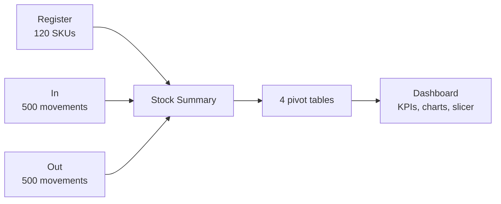

<div align="center">

# 📦 Structuring Company's Stock

**A stock-control system and executive dashboard built entirely in Excel**


[**▶ Open the shared Google Sheets version**](https://docs.google.com/spreadsheets/d/1ASVNzQPtEpx3L61Q62m_8lls28T9e2KF/edit?usp=sharing)

<p>
  <a href="#-overview">Overview</a> •
  <a href="#-workbook-structure">Workbook</a> •
  <a href="#-how-it-works">How It Works</a> •
  <a href="#-dashboard-results">Results</a> •
  <a href="#-insights">Insights</a> •
  <a href="#-how-to-use">How to Use</a> •
  <a href="#-license">License</a>
</p>

</div>

---

## 🔍 Overview

LLC Electronics, the company in a DNC School challenge, kept its stock in scattered spreadsheets: no consolidated balance, no way to spot critical or negative stock and no view by category. This workbook consolidates **product registrations, 500 inbound and 500 outbound movements** into an automatic stock summary, classifies every product by stock status and feeds an **executive dashboard** with pivot tables, charts and a slicer.

| | |
|---|---:|
| 📦 Products (SKUs) | 120 in 7 categories |
| 💰 Net stock value | R$ 10,102,026 |
| 📥 Units in / 📤 units out | 38,816 / 19,878 |
| ⚠️ Products with negative stock | 22 |

## 📒 Workbook Structure

[`analysis.xlsx`](analysis.xlsx) has seven sheets:

| Sheet | Role | Content |
|---|---|---|
| `Register` | Product master data | SKU, product, description, category, price |
| `In` | Inbound movements | Date, SKU, product, quantity (500 rows) |
| `Out` | Outbound movements | Date, SKU, product, quantity (500 rows) |
| `Stock Summary` | Consolidation | Total in, total out, balance, stock value and status per SKU |
| `Dashboard` | Executive panel | 4 pivot tables, 3 charts, a category slicer and KPI cells |
| `Product status` | Lookup | Status labels and their rules |
| `Category` | Lookup | List of the 7 categories |

The original challenge files are in [`Database/`](Database).

## 🔧 How It Works



**Stock Summary formulas (per SKU):**

| Column | Formula |
|---|---|
| Total In | `SUMIF` of the quantities in `In` for the SKU |
| Total Out | `=SUMIF(Out!$B:$B, $A2, Out!$D:$D)` |
| Current Balance | `=D2 - E2` |
| Stock Value (R$) | `=F2 * C2` |
| Product status | `IFS` on the balance, using the rules below |

| Status | Rule |
|---|---|
| Obsolete | balance = 0 |
| Negative Stock | balance < 0 |
| Critical | balance from 1 to 20 |
| OK | balance from 21 to 100 |
| Excess | balance above 100 |

Conditional formatting colors the stock value as positive, zero or negative, and the dashboard KPIs read the pivot tables with `GETPIVOTDATA`.

## 📊 Dashboard Results

| Category | Stock value (R$) | Units out | Average price (R$) | SKUs |
|---|---:|---:|---:|---:|
| Networks | 2,073,021 | 3,147 | 586.83 | 18 |
| Hardware | 1,779,318 | 2,182 | 573.39 | 16 |
| Image & Sound | 1,772,670 | 2,691 | 519.15 | 17 |
| Storage | 1,369,242 | 3,098 | 457.12 | 19 |
| Accessories | 1,161,583 | 3,674 | 561.26 | 20 |
| Peripherals | 978,668 | 2,847 | 563.89 | 16 |
| Components | 967,525 | 2,239 | 476.05 | 14 |
| **Total** | **10,102,026** | **19,878** | **534.67** | **120** |

**Stock status:** Excess 75 · Negative Stock 22 · OK 20 · Critical 3 · Obsolete 0.

## 💡 Insights

| Topic | Finding |
|---|---|
| 💰 Capital | **Networks** holds the most capital in stock (R$ 2.07M) and has the highest average price (R$ 586.83) |
| 🔄 Turnover | **Accessories** moves the most units (3,674 out), followed by Networks (3,147) and Storage (3,098) |
| 📦 Overstock | **75 of 120 products (62.5%)** are in Excess (balance above 100): a sign of capital tied up in stock |
| ⚠️ Data quality | **22 products have negative stock** (more units out than in), totalling −R$ 982,616 of stock value. That usually points to missing inbound records or sales without stock, and it lowers the net total |
| 🔴 Replenishment | Only 3 products are Critical (1 to 20 units) |

## 📁 Project Structure

```
📁 Structuring_Company-s_Stock/
├── 📁 Database/
│   ├── 📄 [Template] Organize os dados ... - Entrada.csv   # Original input data
│   └── 📊 [Template] Organize os dados ... .xlsx            # Original template
├── 📊 analysis.xlsx                                         # Final workbook
├── 📄 LICENSE.md                                            # CC BY-NC-ND 4.0
└── 📄 README.md
```

## 🚀 How to Use

1. **View online:** open the [shared Google Sheets version](https://docs.google.com/spreadsheets/d/1ASVNzQPtEpx3L61Q62m_8lls28T9e2KF/edit?usp=sharing) in your browser, with no installation.
2. **Open in Excel:** download [`analysis.xlsx`](analysis.xlsx) and open it in Microsoft Excel. `IFS` needs Excel 2019 or Microsoft 365.
3. **Try it:** add a movement to `In` or `Out`, then refresh the pivot tables (Data › Refresh All) to update the dashboard.

> Sheet content (product names and categories) is in Portuguese, as provided by the challenge; this README uses the English category names.

## 🤝 Contributing

Contributions, ideas and feedback are welcome!

- 🐛 **Found a bug or something unclear?** [Open an issue](https://github.com/Laurentius96/Structuring_Company-s_Stock/issues/new) describing what happened and how to reproduce it.
- 💡 **Have an idea or a question?** [Open an issue](https://github.com/Laurentius96/Structuring_Company-s_Stock/issues/new) and tell me about it.
- 🔧 **Want to propose a fix?** Fork the repository, create a branch (`git checkout -b fix/short-description`), commit your changes and open a pull request explaining what changed and why.

By contributing, you agree that your contribution is shared under the same license as this project.

## 📜 License

This project is licensed under the [Creative Commons Attribution-NonCommercial-NoDerivatives 4.0 International License (CC BY-NC-ND 4.0)](LICENSE.md).

**What this means:**
- ✅ You may **share** this work with **attribution**
- ❌ You may **not** use it for **commercial purposes**
- ❌ You may **not** distribute **modified versions**

---

<div align="center">

**Lorenzo C. Bianchi** · [GitHub](https://github.com/Laurentius96) · [LinkedIn](https://www.linkedin.com/in/cb-lorenzo/)

</div>
